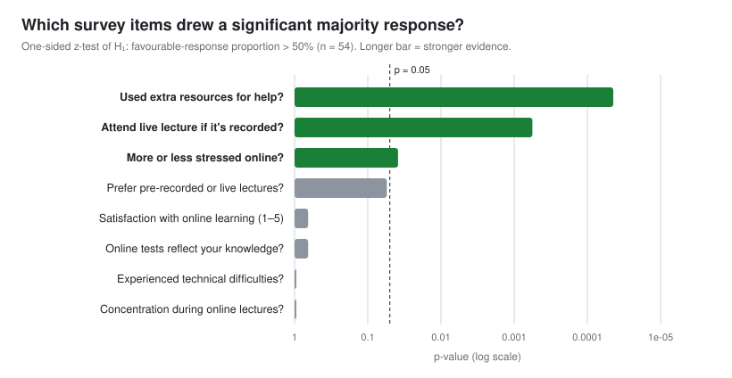

# Student Satisfaction and Commitment to Online Learning During COVID-19


**What share of students were both satisfied with online learning and committed to it?**

This is a survey sampling project (team project, STA304 at the University of Toronto Mississauga, Fall 2022). We designed a questionnaire and computed the required sample size under **stratified random sampling**. We then estimated population proportions with stratified estimators, tested survey items with one-sided z-tests, and used a **bootstrap** to quantify uncertainty. The full write-up is in [`report/online_learning_survey_report.pdf`](report/online_learning_survey_report.pdf).

## Key findings

| | Result |
|---|---|
| **Satisfied with online learning** | Estimated **43%** of students (stratified estimate $\hat p_{st} = 0.432$), below a majority |
| **Satisfied *and* committed** | Estimated **13.5%** ($\hat p_{st} = 0.135$) |
| **Significant majority responses** | Using extra resources (p < 0.0001), attending live lectures even when recorded (p = 0.0006), stress level online (p = 0.039) |
| **Not significant** | Overall satisfaction, lecture-format preference, technical difficulties, concentration, tests reflecting knowledge |

<p align="center">
  
</p>

## Study design

**Population:** STA304H5 Fall 2022 students, in two lecture sections (strata).

**Survey:** 10 questions covering satisfaction (1–5 scale), lecture-format preference, live attendance when recorded, technical difficulties, concentration, stress, use of extra help, whether tests reflect learning, lecture section and gender. It was distributed in person and on Piazza. **54 responses** were collected.

### Sample-size calculation

Under stratified random sampling with proportional allocation ($a_i = N_i/N$):

$$n = \frac{\sum_{i} N_i^2 \, p_i q_i / a_i}{N^2 \frac{B^2}{4} + \sum_{i} N_i \, p_i q_i}$$

The inputs were:
- **Population:** N = 200.
- **Strata:** N₁ ≈ 103 (Wednesday section) and N₂ ≈ 97 (Thursday section), scaled from actual enrolment of 123 and 116.
- **Proportion:** the conservative p = 0.5.
- **Error bound:** B = 0.15.

These give **n ≈ 36.4, so a minimum sample of 37**. The 54 responses collected exceed it.

### Estimation and testing

- **Stratified proportion estimator:** $\hat p_{st} = \sum_i \frac{N_i}{N} \hat p_i$.
- **One-sided z-tests** for each survey item, of H₀: p ≤ 0.5 vs. H₁: p > 0.5.
- **"Satisfied and committed"** was defined as respondents who were satisfied *and* gave the committed answer on all three significant items: attending live lectures, using extra resources, and lower stress.
- **Bootstrap:** 1,000 resamples of the satisfied-and-committed proportion.

## Results

| Survey item | One-sided p-value | Conclusion |
|---|---:|---|
| Did you use extra resources (office hours, Piazza, email)? | 4.4 × 10⁻⁵ | Significant |
| Would you attend live lectures if they were recorded? | 0.00056 | Significant |
| Did you feel more or less stressed online? | 0.0386 | Significant |
| Did you prefer pre-recorded or live lectures? | 0.0550 | Not significant |
| Satisfaction with online learning (1–5) | 0.652 | Not significant |
| Do online tests accurately reflect your knowledge? | 0.652 | Not significant |
| Did you experience technical difficulties? | 0.9996 | Not significant |
| How was your concentration online? | 0.9996 | Not significant |

**Other hypotheses:**
- We found no significant effect of gender on commitment.
- Difficulties experienced during online learning were associated with lower satisfaction.

**Bootstrap:** the report gives a 95% interval of 11.5%–15.6% for the satisfied-and-committed proportion. See the note under Limitations.

## Limitations

- **Small, single-course sample.** The sample of 54 students comes from one course, so the results don't generalize to the wider student body.
- **Strata were assigned after collection.** Respondents were not randomly sampled within each section beforehand, so this is closer to a convenience sample post-stratified by section.
- **Bootstrap interval is likely too narrow.** For a proportion near 0.135 with n = 54, the standard error is about 0.04, even after the finite-population correction. That implies a 95% interval of roughly **6%–21%**. The reported 11.5%–15.6% probably understates the uncertainty.
- **Self-reported, observational data.** Associations between items (for example, stress and commitment) are not causal.

## Repository structure

```
.
├── report/
│   └── online_learning_survey_report.pdf   # Full written report
├── figures/
│   └── survey_item_tests.svg               # README figure
└── scripts/
    └── make_figures.py                     # Regenerates the figure (Python stdlib only)
```

## Skills demonstrated

`Survey design` · `Stratified random sampling` · `Sample-size calculation` · `Stratified estimators` · `One-sided z-tests for proportions` · `Bootstrap resampling` · `R`
